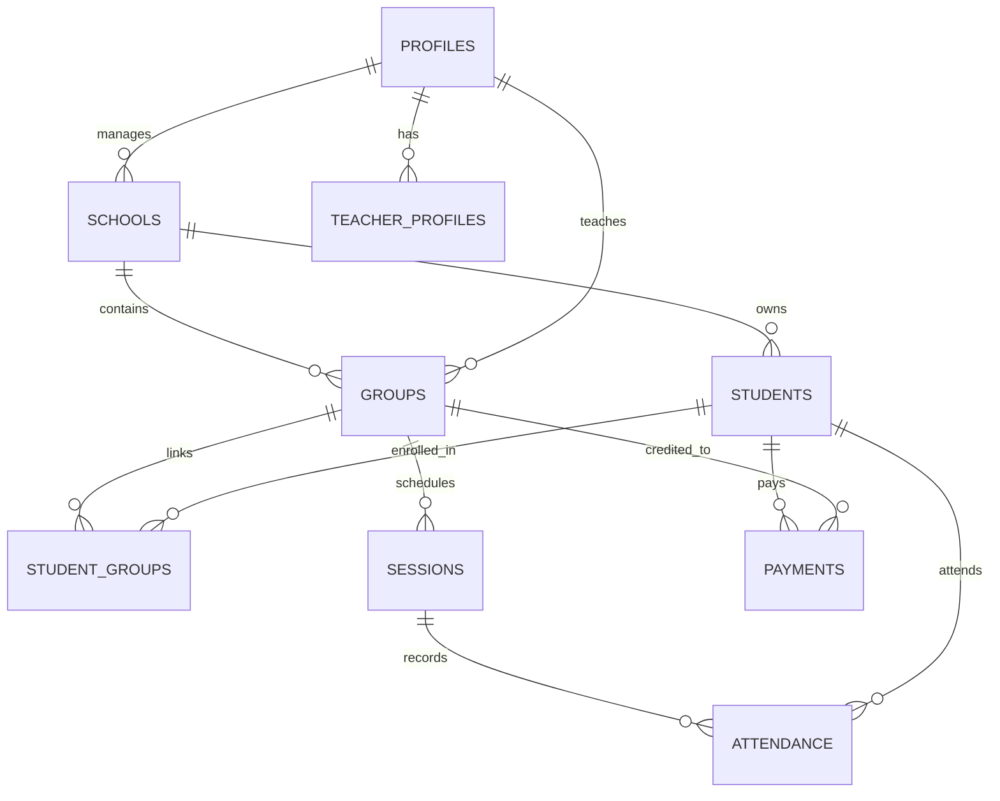

# البنية التقنية وقواعد البيانات (Technical Architecture) ⚙️

يوضح هذا المستند التفاصيل التقنية لمنصة **eCours**، بما في ذلك حزمة التقنيات المستخدمة، مخطط قاعدة البيانات، ونموذج الأمان.

---

## 🛠️ 1. التقنيات المستخدمة (Tech Stack)

- **إطار العمل (Framework):** Next.js 15 (App Router, Turbopack).
- **لغة البرمجة:** TypeScript.
- **إدارة الحالة وجلب البيانات:** TanStack Query v5.
- **الواجهات والتصميم (Styling):** Tailwind CSS v4.
- **قاعدة البيانات والمصادقة (Backend & Auth):** Supabase (PostgreSQL, Auth, RLS Policies).

---

## 🗄️ 2. مخطط قاعدة البيانات (Database Schema & Relationships)

تم بناء قاعدة البيانات بنظام يدعم تعدد المستأجرين (Multi-Tenancy) لتغطية المدارس، المراكز، والأساتذة المستقلين.

### الجداول الرئيسية:
1. **`profiles`**: المستخدمون والأدوار (`superadmin`, `manager`, `teacher`).
2. **`schools`**: المدارس ومراكز الدعم المرتبطة بالمديرين.
3. **`teacher_profiles`**: بيانات تخصص الأستاذ والمرحلة الدراسية.
4. **`groups`**: الأفواج التعليمية وتفاصيل التسعير الشهري/للحصة.
5. **`students`**: بيانات الطلبة ورموز الاستجابة السريعة (`qr_code`) وأرقام هواتف الأولياء.
6. **`student_groups`**: جدول الربط (Many-to-Many) بين الطلبة والأفواج.
7. **`sessions`**: الحصص الدراسية وتواريخها.
8. **`attendance`**: سجلات الحضور، الغياب، والتأخر لكل طالب في الجلسات.
9. **`payments`**: الاشتراكات والمدفوعات المالية المستلمة.

---

## 🚀 3. دليل الدوال البرمجية (Server Actions & APIs)

تعتمد المنصة على **Next.js Server Actions** للعمليات الخلفية بأمان عالي (Zero Client-Side SQL Exposure).

### دوال الاستعلام (`queries.ts`)
- `getTeachersAction`: جلب قائمة الأساتذة حسب الصلاحية.
- `getGroupsAction`: جلب الأفواج مع إحصائيات الطلبة.
- `getStudentsAction`: جلب الطلبة وحالاتهم.
- `getSessionsAction` & `getAttendanceAction`: جلب الحصص وسجلات الحضور.
- `getDashboardStatsAction`: إحصائيات لوحة التحكم.

### دوال التعديل (`mutations.ts`)
- `addGroupAction` / `updateGroupAction` / `deleteGroupAction`: إدارة الأفواج.
- `addStudentAction` / `deleteStudentAction`: إدارة الطلبة وإنشاء QR.
- `createSessionAction` / `recordAttendanceAction`: إدارة الحضور.
- `addPaymentAction`: تسجيل الاشتراكات.

### واجهات (API Routes) للتطوير والاختبار
- `/api/seed-admin`, `/api/seed-manager`, `/api/seed-teacher`: لتوليد بيانات تجريبية ضخمة.
- `/api/reset-db`: لتفريغ قاعدة البيانات بالكامل للتجارب.

---

## 🛡️ 4. نموذج الأمان والصلاحيات (Security & Auth Model)

1. **الطبقة المزدوجة (Dual Layer Security):**
   - **Supabase RLS Policies:** حماية على مستوى السطر (Row Level Security) تمنع أي وصول غير مصرح به لبيانات المستخدمين الآخرين.
   - **Service Role Server Actions:** كافة التعديلات تتم عبر بيئة Node.js سيرفرية آمنة لا يمكن التلاعب بها من متصفح العميل.
2. **وضع التطوير (Dev Mock Override):**
   - يتيح التبديل السلس بين الأدوار لاختبار كافة الصلاحيات محلياً دون تعقيدات تسجيل الخروج والدخول المتكرر.
